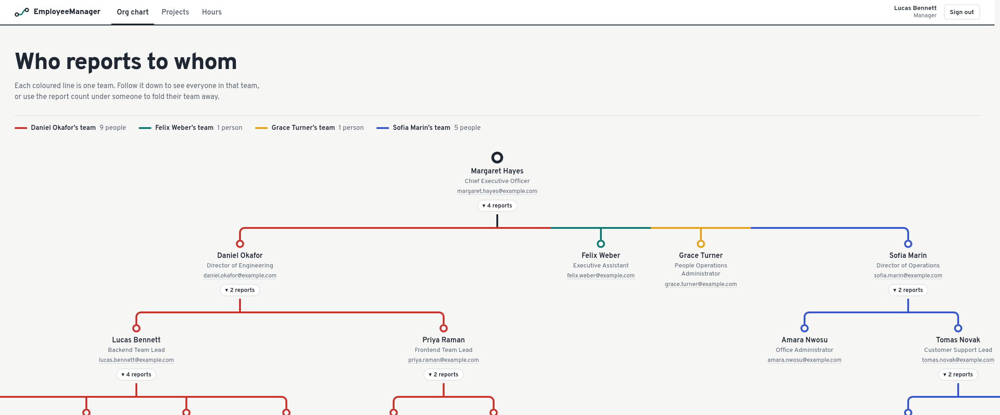
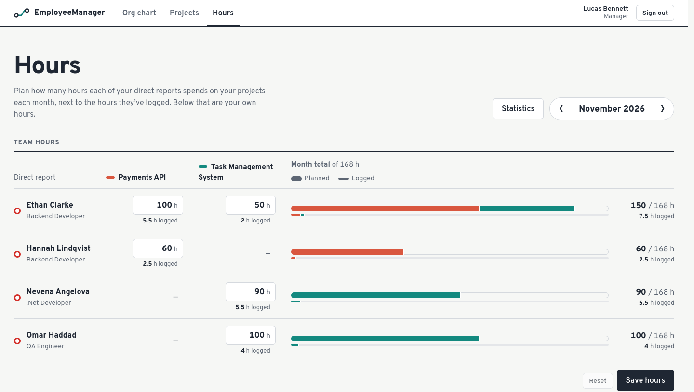
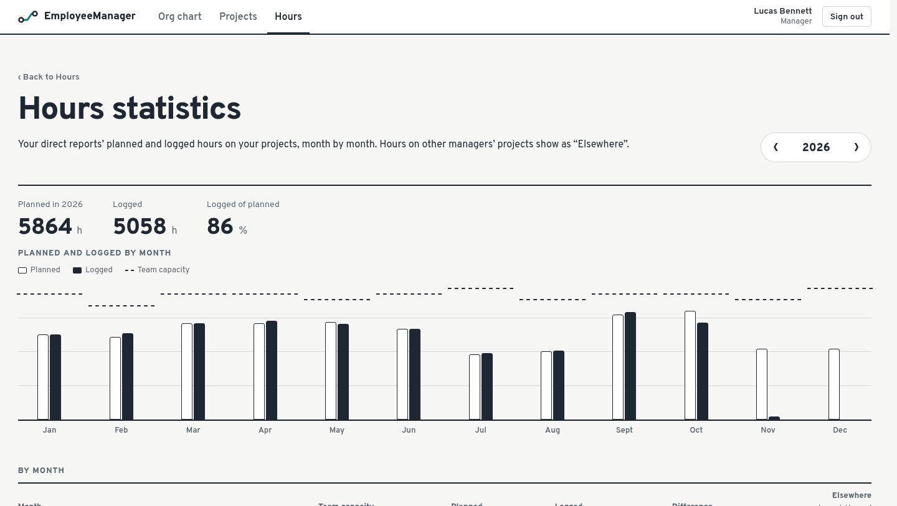
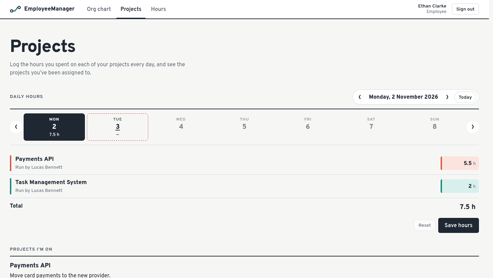
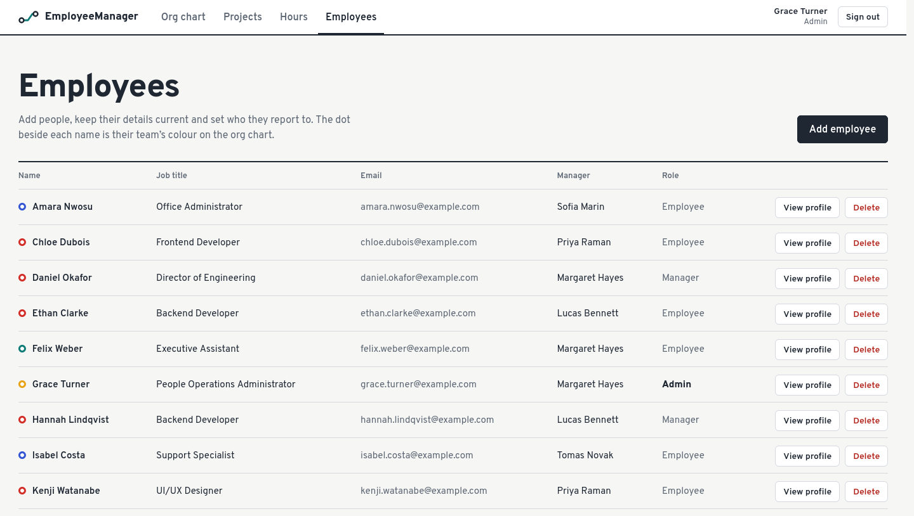
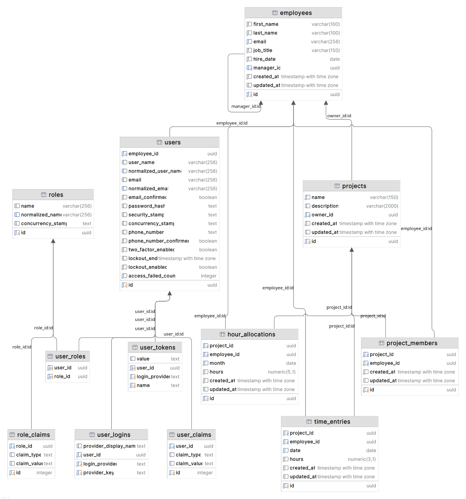

# EmployeeManager

A full-stack web app for running a small company's people and workload. Employees see where they sit in
the organisation and log their daily hours. Managers run projects, plan their team's monthly hours against
capacity and compare planned with logged time. Admins manage employees and their accounts.

**Back end:** ASP.NET Core Web API (.NET 10), EF Core 10 and PostgreSQL 18, built with Clean Architecture.
**Front end:** Angular 22 (standalone, zoneless, signals).
**Quality:** unit, integration and front-end tests run in GitHub Actions CI.

## Features

**Everyone**
- **Org chart:** the company hierarchy drawn top-down as a "transit map". Each team has its own line
  colour, and every card can collapse or expand its team.
- **Daily hours:** log the hours spent on each project per day, with a Monday–Sunday week strip.
  Weekdays with nothing logged are flagged.
- **My hours:** the hours your managers planned for you this month, next to what you actually logged.

**Managers**
- **Projects:** create projects, choose members from your direct reports, and edit or delete them.
- **Team hours:** a month grid of direct reports × projects for planning hours. Rails show each
  person's planned and logged hours against capacity (8 h × weekdays), including hours on other
  managers' projects. Past months are read-only.
- **Statistics:** a year of planned vs. logged hours against team capacity, as a bar chart and broken down
  by month, project and team member.

**Admins**
- **Employee management:** add, edit and delete employees together with their sign-in accounts and roles,
  and view each employee's profile with their manager and direct reports.

## Screenshots

**Org chart:** each team has its own line colour.



| Team hours (Manager) | Statistics (Manager) |
|----------------------|----------------------|
|  |  |
| **Daily hours (Employee)** | **Employees (Admin)** |
|  |  |

## Tech stack

| Layer     | Technology                                                                 |
|-----------|----------------------------------------------------------------------------|
| Back end  | ASP.NET Core Web API (.NET 10), ASP.NET Core Identity, JWT bearer auth     |
| ORM       | Entity Framework Core 10 (Npgsql), code-first migrations                   |
| Database  | PostgreSQL 18                                                              |
| Front end | Angular 22: standalone components, zoneless, signals, `rxResource`, reactive forms |
| Testing   | xUnit (unit and integration tests against real PostgreSQL), Vitest (Angular)   |
| CI        | GitHub Actions (build and tests for both apps, Postgres service container) |

## Architecture and design highlights

```
EmployeeManager/
├── backend/
│   ├── src/
│   │   ├── EmployeeManager.Domain/          # Entities only, no dependencies
│   │   ├── EmployeeManager.Application/     # Use cases by feature, DTOs, pure rule classes
│   │   ├── EmployeeManager.Infrastructure/  # EF Core DbContext, Identity, migrations, seeding
│   │   └── EmployeeManager.Api/             # Thin controllers, auth, configuration
│   └── tests/
│       ├── EmployeeManager.UnitTests/         # Business rules, no database
│       └── EmployeeManager.IntegrationTests/  # Services against a throwaway PostgreSQL database
└── frontend/employee-manager-client/        # Angular app: core/, shared/, features/
```

- **Clean Architecture:** dependencies point inward (`Api → Application, Infrastructure → Application → Domain`).
  The application layer depends on an `IApplicationDbContext` interface, not on EF Core's concrete context.
- **Business rules as pure functions:** manager assignment, project membership, hour allocation, time entry
  and statistics rules live in static classes. They are unit-tested without a database.
- **Role-based security:** JWT sign-in on top of ASP.NET Core Identity, with three roles (Employee,
  Manager, Admin). Every endpoint requires authentication by default, role policies guard the rest, and
  repeated failed logins lock the account.
- **Data integrity:** unique constraints, check constraints and restricted deletes in PostgreSQL, plus
  guards against manager cycles (A → B → A) wherever the hierarchy is walked. Saves that lose a race
  with a concurrent request return `409 Conflict` instead of corrupting data.
- **Consistent API errors:** validation failures come back as `ValidationProblemDetails`, keyed by
  camelCase field so the Angular forms show them under the right input.
- **Testable time:** "current month" and "today" come from an injected `TimeProvider`, so tests can fix the
  date.
- **Modern Angular:** lazy-loaded feature routes, route guards per role, an HTTP interceptor for the
  token, and state in signals instead of Zone.js change detection.

## Database schema

- **`employees`** form the hierarchy through a self-referencing `manager_id`. Each has one sign-in account
  in **`users`**, an ASP.NET Core Identity table (along with `roles`, `user_roles` and the other `user_*` /
  `role_*` tables).
- **`projects`** are owned by a manager (`owner_id`). **`project_members`** links them to employees.
- **`hour_allocations`** hold a manager's monthly plan per employee and project. **`time_entries`** hold
  the hours employees actually log per day.



## Getting started

Prerequisites: .NET 10 SDK, Node.js 22.22+ / 24.15+ / 26+, and PostgreSQL 18 (local or via Docker).

### 1. Database

With Docker:

```bash
docker compose up -d
```

Or with a local PostgreSQL, create the role and database once:

```bash
sudo -u postgres psql -c "CREATE ROLE employee_manager LOGIN CREATEDB PASSWORD 'employee_manager';" -c "CREATE DATABASE employee_manager OWNER employee_manager;"
```

Then apply the migrations:

```bash
dotnet tool restore
dotnet ef database update --project backend/src/EmployeeManager.Infrastructure --startup-project backend/src/EmployeeManager.Api
```

### 2. Run

```bash
dotnet run --project backend/src/EmployeeManager.Api
```

```bash
cd frontend/employee-manager-client && npm install && npm start
```

The API runs on http://localhost:5062 and the UI on http://localhost:4200. In Development the API seeds
sample data on startup: 15 employees, projects, planned hours and a week of logged time.

### 3. Sign in

Every seeded account uses the password `Passw0rd!`.

| Role     | Email                        |
|----------|------------------------------|
| Admin    | `grace.turner@example.com`   |
| Manager  | `margaret.hayes@example.com` |
| Employee | `ethan.clarke@example.com`   |

## Tests

```bash
dotnet test backend/EmployeeManager.slnx   # unit + integration (needs the PostgreSQL above)
cd frontend/employee-manager-client && npm test
```

The integration tests create and drop their own `employee_manager_test_*` databases, so they never touch
the development data.

## API overview

| Endpoint                                     | Access   | Purpose                                     |
|----------------------------------------------|----------|---------------------------------------------|
| `POST /api/auth/login`, `GET /api/auth/me`   | Public / signed in | Sign in and get the current user  |
| `GET /api/employees/org-chart`               | Everyone | Hierarchy as a nested tree                  |
| `GET/POST/PUT/DELETE /api/employees`         | Admin    | Employee and account management             |
| `GET /api/projects/mine`, `/managed`, `/{id}` | Everyone / Manager | Projects you're on or own        |
| `POST/PUT/DELETE /api/projects`              | Manager  | Manage your own projects                    |
| `GET /api/allocations/mine`                  | Everyone | Your planned and logged hours for a month   |
| `GET/PUT /api/allocations/team`              | Manager  | Plan your team's monthly hours              |
| `GET /api/allocations/team/statistics`       | Manager  | A year of planned vs. logged hours          |
| `GET/PUT /api/time-entries/mine`             | Everyone | Log your hours for a day                    |
| `GET /api/health`                            | Public   | Health check, including the database        |

In Development the OpenAPI document is served at `/openapi/v1.json`.
